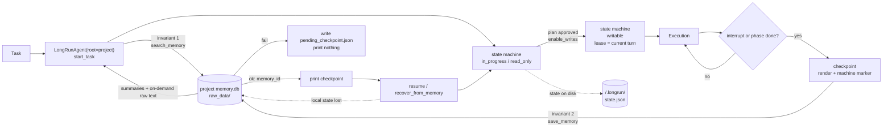
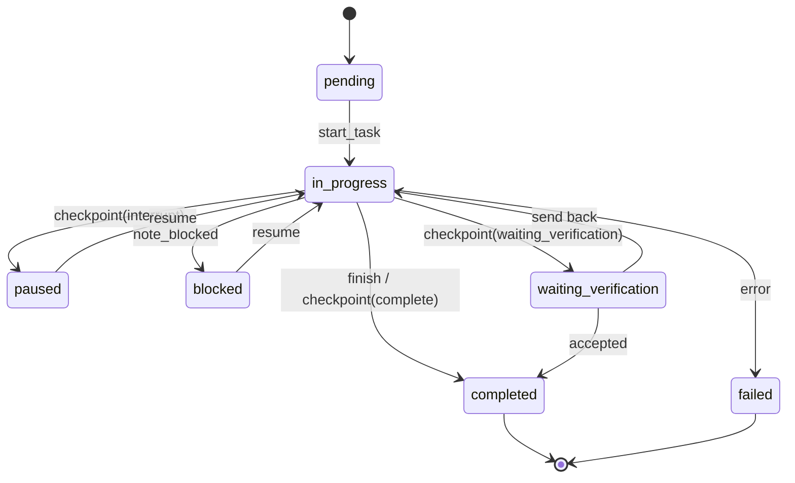

# Agent-LongRun-Framework

English | [简体中文](README.zh-CN.md)

[](pyproject.toml)
[](tests/)
[](LICENSE)
[](https://modelcontextprotocol.io)

Runtime contracts for long-running LLM agents: a 7-state task machine, a
**single-turn write lease**, and project-scoped memory — coupled so that
execution and memory are each other's precondition.

> **Core idea: an agent session works like a product review.**
> **Conversational state (read-only)** is where you align on scope — clarify the
> requirements, argue about the design.
> **Execution state (writable)** is the task handoff after the plan is approved —
> go write code, stop brainstorming.
>
> The 7-state machine decides *talk or build*; the single-turn write lease decides
> *may this turn touch files*. Conversation and execution are physically separated,
> so the agent cannot keep editing after the approval expires.

Not another agent framework. No LLM calls, no orchestration DSL. It is a thin
layer that answers three questions an agent runtime keeps getting wrong:

1. **What state is this task in, and is this transition legal?**
2. **Is the agent allowed to touch files right now?**
3. **If the process dies, where does the real progress live?**

## Why

| State machine alone | Memory alone | Coupled (this repo) |
|---|---|---|
| Checkpoints are local; lost on a new machine | Progress exists, but nothing constrains when it is read or written | Local hot state + cold memory backup, each a recovery path |
| Any state can be jumped to | Any progress can be overwritten | Illegal transitions fail; unfinished work cannot be clobbered |
| Records *what*, not *why* | Records results, not boundaries | Decisions, phases, and gate state are archived together |

The core loop:

```text
start_task → search memory → work under the state machine
          → checkpoint: save memory first, print the checkpoint second
          → resume / recover on another process or machine
```

## The single-turn write lease (v3)

v2 shipped `enable_writes()` as a persistent switch. That is the wrong default:
the user approves **one** action, and the agent keeps writing files in every
later turn.

v3 makes write permission a lease bound to a conversation turn:

- `TaskState.turn_index` tracks the current turn.
- `enable_writes(reason)` binds `write_lease_turn` to the current turn.
- `begin_turn()` / `end_turn()` / `checkpoint()` / `resume()` /
  `recover_from_memory()` all revoke the lease.
- `require_writable()` checks both `access_mode` and `write_lease_turn`; a stale
  lease raises `WriteGateViolation` even if `access_mode` still says `writable`.
- A legacy v2 state that was `writable` is downgraded to `read_only` on load.

```python
agent.enable_writes("plan approved")
agent.require_writable("edit adapters/xometry.py")   # OK, turn 1

agent.begin_turn("next user message")
agent.require_writable("keep editing")               # raises WriteGateViolation

agent.enable_writes("new plan approved")
agent.require_writable("keep editing")               # OK, turn 2
```

The host is responsible for calling `begin_turn()` when a new user message
arrives — the framework cannot see message boundaries by itself. `resume()`
already includes one `begin_turn`; do not call it twice for the same message.

## Quickstart

Install the memory router and this framework straight from Git:

```bash
python -m pip install "agent-memory-router @ git+https://github.com/lss486558354-ship-it/agent-memory-router-v2.git"
python -m pip install "agent-longrun-framework @ git+https://github.com/lss486558354-ship-it/Agent-LongRun-Framework-v3.git"

agent-longrun demo
```

The demo runs the whole loop in a temp directory:

```text
start_task (read-only)
  → enable_writes (unlocks the current turn only)
  → checkpoint (save memory first, then print the checkpoint)
  → new Agent resume (back to read-only, next turn)
  → write attempt rejected: the lease did not survive resume
  → enable_writes again
  → finish
```

Expected final line: `OK: checkpoint -> resume -> single-turn write lease -> finish`.

If `agent-longrun` is not on `PATH`, activate the virtualenv you installed into.

### From source

```bash
git clone https://github.com/lss486558354-ship-it/agent-memory-router-v2.git
git clone https://github.com/lss486558354-ship-it/Agent-LongRun-Framework-v3.git

cd Agent-LongRun-Framework-v3
python -m pip install -e ".[dev]"
python -m pip install -e ../agent-memory-router-v2

python -m pytest tests/ -q                    # 52 passed
python examples/01_interrupted_task.py        # in-process backend
python examples/01_interrupted_task.py --mcp  # real MCP stdio
```

The router is located in this order: `AGENT_MEMORY_ROUTER_PATH` → an installed
`memory_core` / `mcp_server` module → a sibling directory → the current working
directory. Both pip installs and side-by-side clones work.

## Architecture



`LongRunAgent(root=...)` decides two things at once:

- hot state → `<root>/.longrun/state.json`
- the default `MCPMemoryBackend` → launched with `--project_path <root>`, so
  memory lands in `<root>/memory.db`

`resume()` can therefore never mix one project's state with another project's
history.

### State machine



Transitions are whitelisted. Anything else raises `TransitionError`; terminal
states have no exits.

## Core invariants

1. **Memory before execution.** `start_task()` calls `search()` before it creates
   state. No memory lookup, no task.
2. **Memory before checkpoint output.** `checkpoint()` calls `save()` before it
   returns text. If the save fails, it writes `.longrun/pending_checkpoint.json`
   and raises `CheckpointWriteError` — it never prints a checkpoint that was not
   persisted.
3. **Write permission expires.** One approval covers one turn. Checkpointing,
   resuming, recovering, and ending a turn all revoke it.
4. **One project, one root.** State and memory share the same `root`; unfinished
   tasks cannot be overwritten by a new `start_task`.

## Usage

```python
from workflow_manager import LongRunAgent

agent = LongRunAgent(root="D:/my-project")   # state + default memory bound here

# 1. Start: search_memory first, then create read-only state
started = agent.start_task("implement the quoting adapter")
print(started.memories)   # project-scoped summaries
print(started.context)    # on-demand raw text (top 1 by default)

# 2. Research done: unlock writes for this turn
agent.enable_writes("read the old plan, moving to implementation")
agent.require_writable("edit adapters/xometry.py")

# 3. Interrupt: memory first, checkpoint second
checkpoint = agent.checkpoint(
    reason="token budget warning",
    summary="Xometry read-only prober is done",
    next_step="wire up Protolabs",
    decisions=["read-only probing first, no login automation"],
)
print(checkpoint.text)    # last line: <!-- longrun-state: {...} -->

# 4. New process, same project root
agent = LongRunAgent(root="D:/my-project")
bundle = agent.resume()
print(bundle.state.status, bundle.state.next_step)

# 5. v3: resume is read-only again — re-authorize before writing
agent.enable_writes("confirmed after resume")
agent.require_writable("continue editing adapters/xometry.py")

# 6. Phase archive / finish
agent.complete_phase("phase 2: Xometry", "read-only probe passed",
                     decisions=["login required"], next_step="phase 3")
agent.finish("all adapters wired and verified")
```

On a new machine, with local state gone (also read-only — re-authorize writes):

```python
agent = LongRunAgent(root="/new/machine")
bundle = agent.recover_from_memory("T_20261024_155703_2f9c")
agent.enable_writes("confirm the recovered next step")
```

## Memory backends

| Backend | Use | Notes |
|---|---|---|
| `MCPMemoryBackend` (default) | production / cross-process | spawns an MCP stdio child per call with `--project_path` |
| `LocalMemoryBackend` | examples / same machine | in-process `memory_core.configure(project_path)` |
| `InMemoryBackend` | tests | records calls so ordering can be asserted |

Protocol: `search / read_raw / save / link`.

```python
MCPMemoryBackend(project_path="D:/my-project")
LocalMemoryBackend(project_path="D:/my-project")

# v0.1 spelling still works
MCPMemoryBackend(home="D:/my-project")
```

`LocalMemoryBackend` binds the project root as module-level global state: do not
switch projects inside one process. Use one `MCPMemoryBackend` per project.

## Set up a real project

```bash
cd D:/my-project
agent-projects init
```

This writes `.mcp.json`, `.cursorrules`, a skill, and `.gitignore`, and creates
`memory.db` / `raw_data/`. Then:

```python
agent = LongRunAgent(root="D:/my-project")
```

The Python API does not depend on `.mcp.json`; it passes `--project_path` to the
MCP child itself. The JSON file is for agents running inside Claude Code or
Cursor. Both point at the same project.

## Design decisions

**Why bind state and memory to the same root?**
A checkpoint restores *this project's* progress. If state lives in A and memory
in B, `resume()` will take A's `next_step` and look it up in B's history, with no
way to tell which side is right.

**Why save memory before printing a checkpoint?**
The printed checkpoint is a receipt. Reverse the order and a killed process
leaves the chat log as the only copy — the least durable store in the system.

**Why a JSON marker inside the checkpoint?**
Recovering from prose forces the model to guess status. The marker lets
`recover_from_memory()` rebuild `TaskStatus / AccessMode / completed_steps`
exactly.

**Why both local state and memory?**
`.longrun/state.json` is the hot path: fast and atomic. Memory is the cold
backup: cross-machine, cross-session. On conflict, the checkpoint in memory wins
because it passed through a user-visible output path.

**Why read-only by default?**
The most common damage during research is editing before the design is settled.
The gate turns "I approve the plan" into an explicit, audited action.

**Why expire write permission every turn?**
The failure mode is not the first approval — it is every turn after it. A user
approves one edit; the agent keeps writing for the rest of the session. A lease
turns approval into a bounded, auditable event with defined revocation points.

**Why fail on a corrupted state file?**
Treating it as "no task" lets the next `start_task` overwrite real progress.
Stopping is cheaper.

## How this differs

| Project | What it gives you | What this adds |
|---|---|---|
| LangGraph | Graph orchestration, checkpointer | A task-state contract and per-turn write gate enforced outside the graph |
| Temporal | Durable workflow execution | A local, file-based contract an LLM can be held to; no cluster |
| Mem0 / vector stores | Semantic long-term memory | Project-scoped SQLite + raw text, with the *write ordering* as the invariant |
| Claude Code hooks | Host-level tool interception | Backend-agnostic Python API + MCP, usable from any host |

This is deliberately small: state machine, memory client, and glue. It is meant
to be embedded, not to own your runtime.

## Known limitations

- `begin_turn()` must be called by the host on each new user message; the
  framework cannot detect message boundaries.
- `resume()` / `recover_from_memory()` already start a new turn — do not call
  `begin_turn()` again for the same message.
- Every MCP call spawns a child process; high-frequency retrieval needs a
  persistent connection or the local backend.
- `LocalMemoryBackend` uses a process-global project root.
- Keyword extraction is heuristic; there are no embeddings.
- The state file has no lock; concurrent writers on one `.longrun/` are unsupported.
- The API is synchronous; wrap it in a thread pool for async hosts.
- Windows consoles need `PYTHONIOENCODING=utf-8`; examples reconfigure stdout.

## Tests

```bash
python -m pytest tests/ -q
```

The suite covers, among others:

- illegal transitions fail, terminal states have no exits
- `start_task`'s first backend call is `search`
- `checkpoint`'s first backend call is `save`; failure returns no checkpoint
- read-only mode blocks writes; `enable_writes` allows them
- the lease expires on `begin_turn` / `end_turn` / `checkpoint` / `resume` /
  `recover_from_memory`
- a stale lease is rejected even when `access_mode` is still `writable`
- a legacy v2 `writable` state is downgraded on load
- `recover_from_memory()` rebuilds state from the machine marker
- the default backend receives the same `project_path` as `root`
- the MCP child receives `--project_path <root>`
- the router resolves from an installed module or a sibling directory
- `agent-longrun demo` exits 0

## License

MIT
